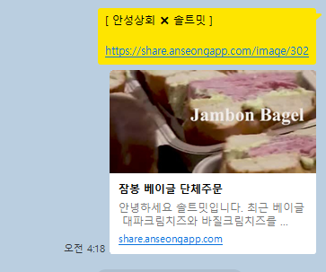

<h1 align="center">공유 템플릿 모듈</h1>
<h3 align="center">앱 링크 공유 시 미리보기를 보여드리기 위한 모듈입니다</h3>
   

</img>
</img>

   

share.anseongapp.com으로 서버 요청이 들어오는 경우 Path와 Query를 참고하여 DB에 데이터를 로드하고 Thymeleaf를 활용하여 Open Graph 템플릿을 전송해주는 모듈입니다.